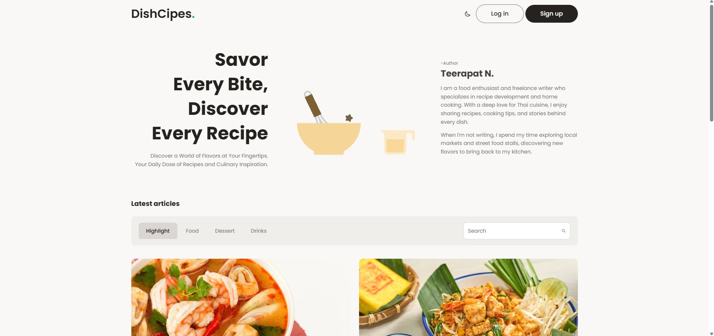

# DishCipes — Food Blog & CMS

A food blog where people read recipes and restaurant reviews, follow writers, and comment.
Built solo as a personal project during the TechUp Full-Stack Developer Bootcamp.

**Live demo:** https://dish-cipes-blog.vercel.app



## Features

- Sign up with email verification, login, and user profiles
- Articles for recipes and restaurant reviews, with category tabs and search
- Likes, comments, and following other writers
- Real-time notifications
- Admin dashboard to manage articles, categories, and users, with charts
- Image uploads for articles and profiles
- Dark mode and responsive layout for desktop and mobile

## Tech Stack

| Layer | Technology |
| --- | --- |
| Frontend | React 19, TypeScript, Vite, Tailwind CSS v4, React Router v7 |
| Backend | Supabase (Auth, Database, Storage, Realtime) |
| Database | PostgreSQL (via Supabase) |
| Charts & Animation | Recharts, lottie-react |
| Deployment | Vercel |

## Getting Started

### Prerequisites

- Node.js (LTS)
- A Supabase project

### Installation

```bash
git clone https://github.com/tsuch11/DishCipes-blog.git
cd DishCipes-blog
npm install
```

### Environment Variables

Create a `.env` file in the project root:

```bash
VITE_SUPABASE_URL=your-supabase-project-url
VITE_SUPABASE_ANON_KEY=your-supabase-anon-key
```

| Name | Description |
| --- | --- |
| `VITE_SUPABASE_URL` | Supabase project URL |
| `VITE_SUPABASE_ANON_KEY` | Supabase anonymous (public) key |

### Scripts

| Command | Description |
| --- | --- |
| `npm run dev` | Start the development server |
| `npm run build` | Type-check and build for production |
| `npm run preview` | Preview the production build locally |
| `npm run lint` | Run ESLint |

## Testing

Each feature was tested manually before deployment by walking through the main user flows:
sign-up and email verification, login, creating and editing articles, liking, commenting,
following, notifications, and admin actions, on both desktop and mobile.

## AI-Assisted Development

- **Claude Code:** used during coding and debugging to generate components, trace errors, and refactor code.

## What I Learned

- TODO: a real problem you hit and how you solved it (e.g. duplicate real-time notifications, Supabase RLS policies)
- TODO: a second one

## Author

**Teerapat Nobthai** — [LinkedIn](https://linkedin.com/in/teerapat-nobthai-5451b141b) · [GitHub](https://github.com/tsuch11)
